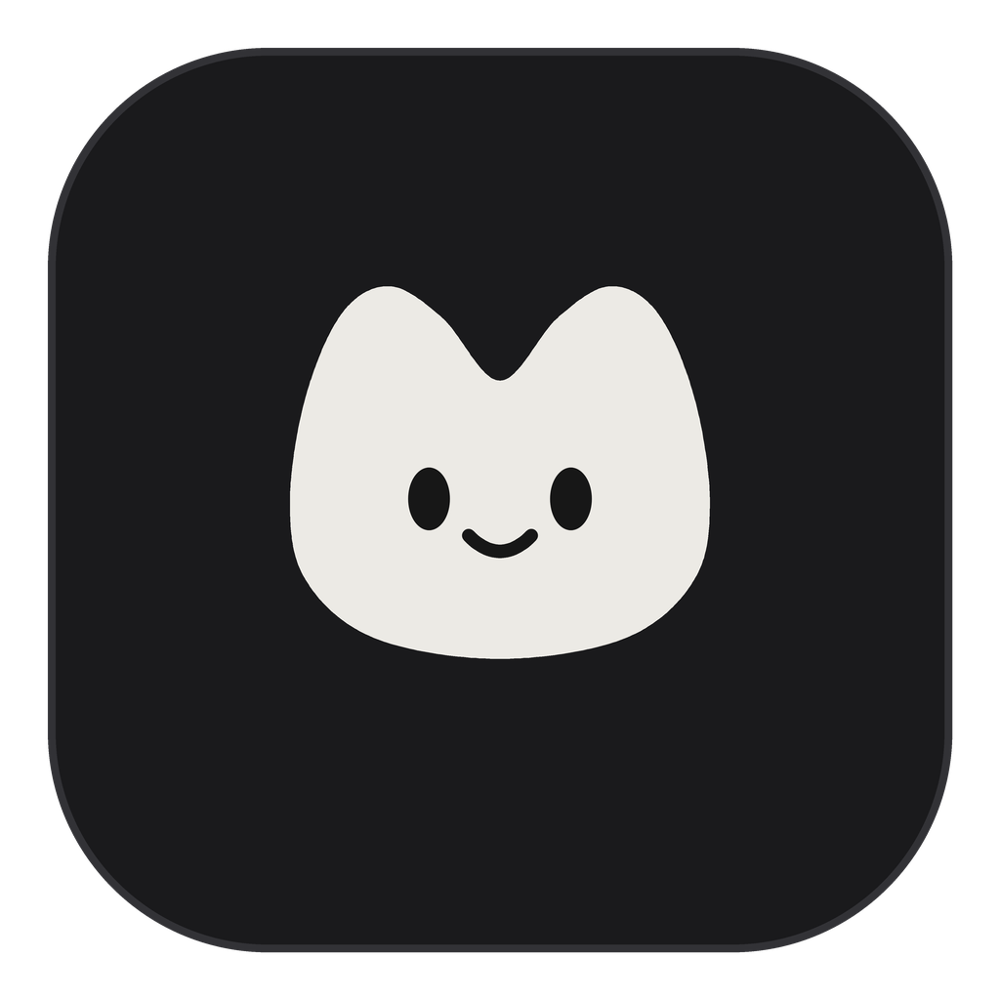
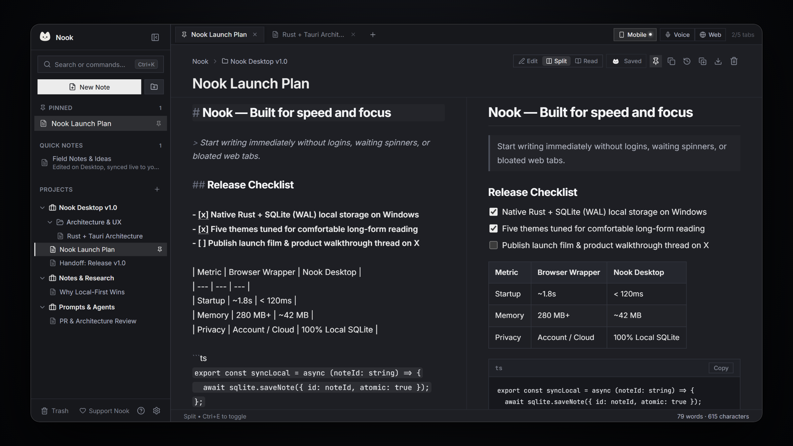
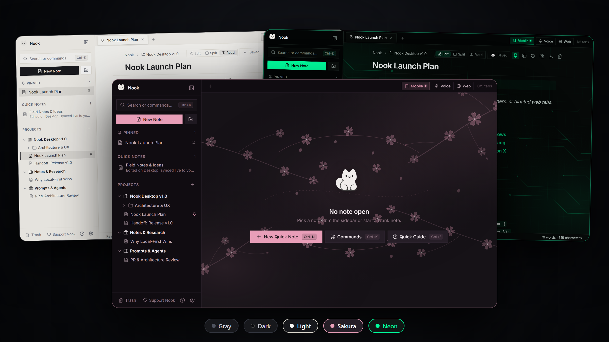
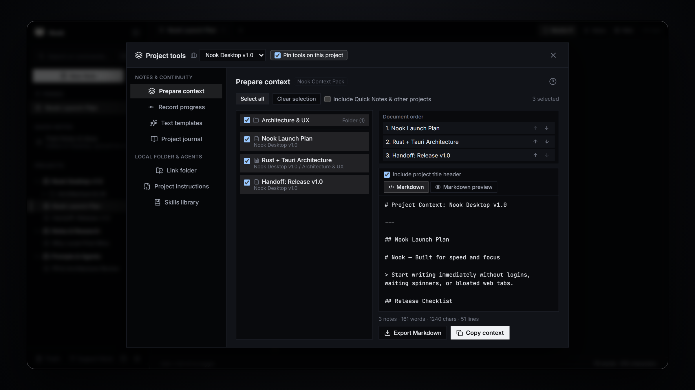
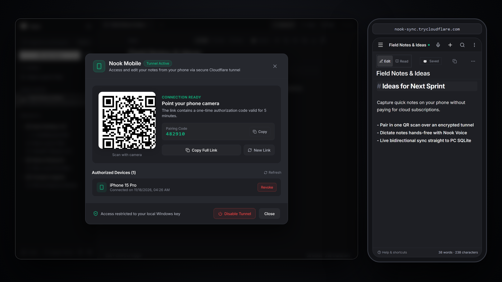
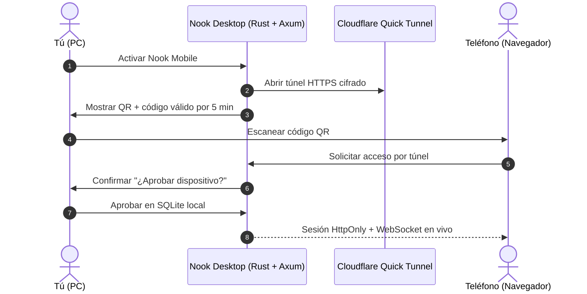
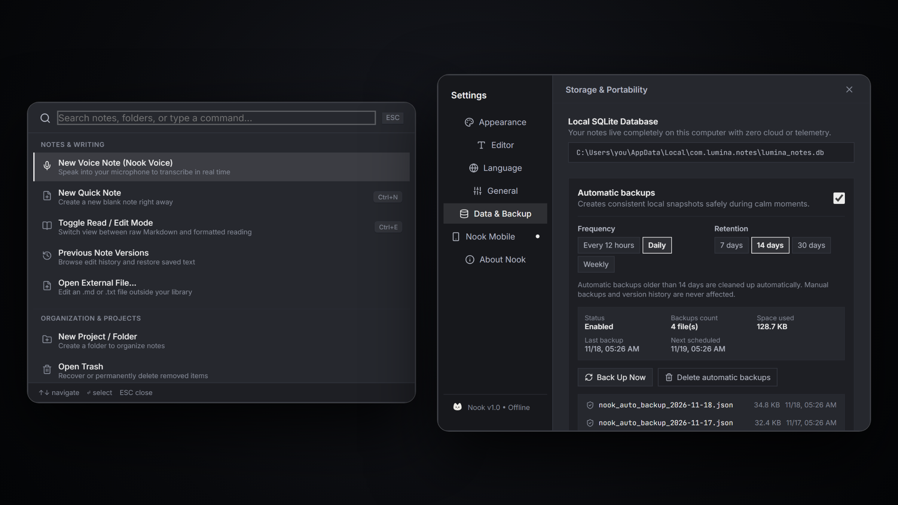

<div align="center">

<br />


&nbsp;&nbsp;&nbsp;


# Nook

### Tu espacio minimalista, rápido y 100% local-first para notas, proyectos y flujos de trabajo en Windows, Web y Mobile.

<p>
  <strong>🌐 Idioma:</strong>
  &nbsp;<a href="./README.md">English</a>
  &nbsp;•&nbsp;
  <a href="./README.pt-BR.md">Português (BR)</a>
  &nbsp;•&nbsp;
  <b>Español</b>
</p>

<p>
  <a href="https://github.com/zeitgeist2004/Nook/releases/latest">
    
  </a>
  
  
  
  <a href="./LICENSE">
    
  </a>
</p>

<p>
  <a href="#-descarga-e-instalación-windows">⬇️ Descargar</a> •
  <a href="#-captura-y-markdown-en-vista-dividida">✨ Markdown</a> •
  <a href="#-cinco-temas-visuales">🎨 Temas</a> •
  <a href="#-flujo-dev-y-agentes-de-ia">⚡ Flujo Dev</a> •
  <a href="#-nook-web-mobile-y-voz">📱 Mobile y Voz</a> •
  <a href="#-búsqueda-instantánea-y-backups-offline">🔍 Búsqueda y Backups</a> •
  <a href="#-compilar-desde-el-código-fuente">🛠️ Compilar</a>
</p>

</div>

---

## ✨ Captura y Markdown en Vista Dividida

**Deja de perder ideas en decenas de `.txt` sueltos o esperar a que abran apps pesadas basadas en navegador solo para escribir una línea.**  
Abre Nook y empieza al instante — sin cuentas, sin nube obligatoria y con velocidad nativa en Rust + SQLite.

<p align="center">
  
</p>

- **Edición, Vista Dividida y Lectura en un clic (`Ctrl + E`):** Escribe Markdown en CodeMirror 6 mientras ves tablas, listas de tareas, citas, callouts y bloques de código renderizados en vivo al lado.
- **Organización clara y sin ruido:** Mantén **Notas Rápidas** y notas fijadas siempre a mano, organiza proyectos en subcarpetas anidadas con drag & drop y trabaja en hasta **5 pestañas abiertas** al mismo tiempo.
- **Auto-Save atómico en 350ms e historial:** Cada pulsación se guarda en SQLite local (`WAL`) con indicador **`Saved`** en tiempo real, recuperación tras cierres inesperados y versiones restaurables.
- **Edición directa de archivos `.md` y `.txt` en Windows:** Clic derecho en cualquier archivo → **Abrir con Nook** para editar directo en disco (UTF-8, UTF-16 y Windows-1252).

<details>
<summary><b>📝 Sintaxis Markdown Completa (Callouts, Wikilinks, Checklists y Frontmatter)</b></summary>
<br />

- **Bloques Callout:** `> [!note]`, `> [!tip]`, `> [!warning]` e `> [!important]` con estilos limpios.
- **Wikilinks `[[Nota]]`:** Conecta notas con `[[Nombre de Nota]]` o `[[Nota Destino|Texto]]` — haz clic en modo lectura para navegar o crear la nota al instante.
- **Checklists interactivas:** Marca o desmarca `- [ ] Tarea` directamente en modo lectura actualizando el Markdown en tiempo real.
- **Frontmatter YAML y etiquetas:** Metadatos al inicio (`---`) presentados en tarjeta limpia + soporte para `#tags`.

</details>

---

## ⬇️ Descarga e Instalación (Windows)

Elige el formato que prefieras en **[GitHub Releases](https://github.com/zeitgeist2004/Nook/releases/latest)**:

| Formato | Ideal para | Descarga Directa |
| :--- | :--- | :--- |
| **Instalador `.exe` (NSIS)** | Instalación estándar en Windows con accesos directos, asociación `.md`/`.txt` y actualizaciones automáticas *(Recomendado)* | [](https://github.com/zeitgeist2004/Nook/releases/latest) |
| **Instalador `.msi` (Windows Installer)** | Paquete MSI estándar para Windows x64 | [](https://github.com/zeitgeist2004/Nook/releases/latest) |
| **Versión Portátil (`.zip`)** | Extraer y usar sin instalar (incluye `Nook.exe`, `WebView2Loader.dll` y `cloudflared.exe`) | [](https://github.com/zeitgeist2004/Nook/releases/latest) |
| **Ejecutable Independiente (`.exe`)** | Ejecución directa de `Nook.exe` | [](https://github.com/zeitgeist2004/Nook/releases/latest) |

> [!TIP]
> ¿Quieres abrir archivos `.md` o `.txt` directamente con Nook? Haz clic derecho sobre el archivo → **Abrir con** → **Nook** → **Siempre**.

---

## 🎨 Cinco Temas Visuales

**Las pantallas blanco puro cansan la vista de noche, y los temas grises planos quitan las ganas de leer.**  
Nook incluye cinco temas calibrados para largas sesiones de lectura y código — sincronizados entre **Desktop, Web y Mobile**.

<p align="center">
  
</p>

- **Sakura (`sakura`) y Neon (`neon`):** Atmósferas minimalistas exclusivas — tonos ciruela suaves con flores de cerezo `#E89EB8`, o estética terminal con trazos PCB y retícula verde `#00FF9D`.
- **Claro (`white`), Oscuro (`dark`) y Gris (`gray`):** Papel cálido editorial (`#FAF9F6`) para leer de día, contraste profundo (`#090A0D`) para enfoque nocturno y grafito equilibrado como predeterminado.
- **Interfaz Multilingüe Nativa:** Soporte completo en **English**, **Português (BR)** y **Español**, además de personalización tipográfica en el editor.

---

## ⚡ Flujo Dev y Agentes de IA

**¿Cansado de buscar prompts antiguos, documentos dispersos y recordar dónde dejaste un proyecto antes de programar?**  
Sin convertir tu bloc de notas en un IDE pesado, **Herramientas de Proyecto** prepara todo tu contexto en segundos.

<p align="center">
  
</p>

- **Context Pack en 1 clic (`Prepare context`):** Selecciona notas y carpetas, ordena los documentos, previsualiza el Markdown unificado y copia o exporta el contexto completo con un clic.
- **Continuidad entre sesiones:** Registra **Session Handoffs** (`Record progress`), mantén un **Diario de proyecto** y guarda **Plantillas de texto** reutilizables junto a tus notas.
- **Carpeta local e instrucciones para agentes:** Vincula la carpeta local de un repositorio para consultar archivos `CLAUDE.md`, `AGENTS.md` y tu biblioteca local de skills (`SKILL.md`).

---

## 📱 Nook Web, Mobile y Voz

**Captura una idea desde el celular o consulta tus notas desde otro navegador — sin subir tu biblioteca a ninguna nube de pago.**  
Tu PC sigue siendo el único almacenamiento real mientras Nook sincroniza en vivo por red local o túnel cifrado.

<p align="center">
  
</p>

- **Emparejamiento por QR (`Cloudflare Quick Tunnel`):** Activa Nook Mobile, escanea el código QR desde la cámara del teléfono (código temporal de 5 minutos) y aprueba la conexión 2FA directamente en Windows.
- **Control total de dispositivos:** Administra cada acceso bajo **Dispositivos Autorizados**, vincula el permiso a tu clave local de Windows y pulsa **Revocar** al instante cuando quieras cerrar una sesión.
- **Nook Web (`127.0.0.1`) y Nook Voice:** Abre tu biblioteca desde el navegador local vía servidor Rust **Axum** con WebSockets en vivo, o dicta notas por voz con cola de recuperación sin conexión.

<details>
<summary><b>🔐 Cómo funciona el emparejamiento seguro sin nube (Diagrama)</b></summary>
<br />



Consulta [docs/NOOK_MOBILE.md](./docs/NOOK_MOBILE.md) para ver el modelo completo de seguridad y protección contra DNS rebinding.

</details>

---

## 🔍 Búsqueda Instantánea y Backups Offline

**Tu espacio de notas debe seguir siendo instantáneo incluso con miles de archivos — y tus datos siempre deben ser tuyos en formatos abiertos.**

<p align="center">
  
</p>

- **Paleta de Comandos sin latencia (`Ctrl + K` / `Ctrl + P`):** Búsqueda de texto completo con SQLite **FTS5** — encuentra notas al vuelo, inicia **Nook Voice**, consulta versiones anteriores, abre archivos externos `.md`/`.txt` o gestiona la Papelera desde el teclado.
- **Backups locales automáticos en `.json`:** Programa copias en segundo plano (**Cada 12 horas**, **Diariamente** o **Semanalmente**) con limpieza configurable (**7**, **14** o **30 días**) — los backups manuales y el historial de versiones nunca se borran automáticamente.
- **Exportación completa en `.md` y actualizaciones firmadas:** Exporta toda tu biblioteca en carpetas `.md` estándar en cualquier momento y recibe actualizaciones firmadas mediante GitHub Releases.

<details>
<summary><b>⌨️ Atajos de Teclado Esenciales</b></summary>
<br />

| Atajo | Acción |
| :--- | :--- |
| `Ctrl + N` | Nueva nota rápida |
| `Ctrl + Alt + N` | Captura rápida global (Windows) |
| `Ctrl + K` o `Ctrl + P` | Búsqueda instantánea y paleta de comandos |
| `Ctrl + E` | Alternar Editar / Dividir / Lectura |
| `Ctrl + B` | Mostrar u ocultar barra lateral |
| `Ctrl + S` | Guardar inmediatamente |
| `Ctrl + ,` | Abrir Configuración |
| `Ctrl + /` | Guía rápida de atajos |

</details>

---

## 🔒 Privacidad y Arquitectura

| Capa | Tecnología |
| :--- | :--- |
| **Core Desktop** | Tauri 2 + Rust (Edition 2024) |
| **Base de Datos** | SQLite local (`WAL` + `FTS5` + claves foráneas) |
| **Frontend** | React 18 + TypeScript + Vite |
| **Editor y Vista Previa** | CodeMirror 6 + `marked` + `DOMPurify` |
| **Sync y Túnel** | Servidor Axum HTTP/WebSocket integrado + Cloudflare Quick Tunnel opcional |

- Cero cuentas, cero analíticas, cero telemetría de terceros.
- Todas tus notas, copias de seguridad y ajustes permanecen en tu computadora.

---

## 🛠️ Compilar desde el Código Fuente

### Requisitos
- **Node.js >= 18** y **npm**
- **Rust >= 1.90** (`rustup` / `cargo`) y requisitos de Tauri en Windows (WebView2 + MSVC Build Tools)

```bash
# 1. Instalar dependencias del frontend
npm install

# 2. Ejecutar suite de pruebas y verificación de tipos
npm test
npx tsc --noEmit

# 3. Iniciar modo desarrollo de escritorio
npm run tauri dev

# 4. Compilar ejecutable final e instaladores de Windows
npm run tauri build
```

---

## ❤️ Apoyar a Nook

Nook es 100% gratuito y de código abierto — sin muros de pago, sin anuncios y sin funciones Pro bloqueadas.  
Si te ayuda en tu día a día, puedes apoyar el desarrollo en **[GitHub Sponsors](https://github.com/sponsors/zeitgeist2004)**.

<div align="center">
  <br />
  
  <br />
  <sub>Creado por <a href="https://github.com/zeitgeist2004">zeitgeist2004</a> • <a href="./LICENSE">Licencia MIT</a></sub>
</div>
