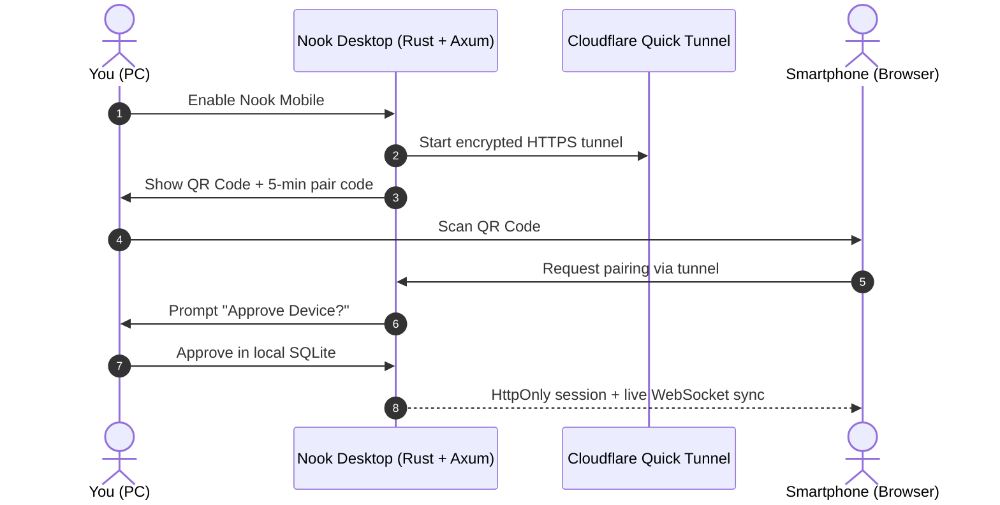

<div align="center">

<br />


&nbsp;&nbsp;&nbsp;


# Nook

### Minimalist, fast, 100% local-first notes and project workspace for Windows, Web, and Mobile.

<p>
  <strong>🌐 Language:</strong>
  &nbsp;<b>English</b>
  &nbsp;•&nbsp;
  <a href="./README.pt-BR.md">Português (BR)</a>
  &nbsp;•&nbsp;
  <a href="./README.es.md">Español</a>
</p>

<p>
  <a href="https://github.com/zeitgeist2004/Nook/releases/latest">
    
  </a>
  
  
  
  <a href="./LICENSE">
    
  </a>
</p>

<p>
  <a href="#-download--install-windows">⬇️ Download EXE / Installer</a> •
  <a href="#-key-features">✨ Features</a> •
  <a href="#-interactive-feature-tour">🎨 Deep Dive</a> •
  <a href="#-privacy--architecture">🔒 Architecture</a> •
  <a href="#-build-from-source">🛠️ Build</a>
</p>

</div>

---

## ⬇️ Download & Install (Windows)

Pick your preferred format from **[GitHub Releases](https://github.com/zeitgeist2004/Nook/releases/latest)**:

| Format | Best For | Direct Download |
| :--- | :--- | :--- |
| **`.exe` Installer (NSIS)** | Standard Windows installation with shortcuts, `.md` / `.txt` file associations, and built-in auto-updates *(Recommended)* | [](https://github.com/zeitgeist2004/Nook/releases/latest) |
| **`.msi` Installer (Windows Installer)** | Enterprise / standard x64 Windows Installer package | [](https://github.com/zeitgeist2004/Nook/releases/latest) |
| **Portable `.zip`** | Extract and run anywhere without installing (includes `Nook.exe`, `WebView2Loader.dll`, and `cloudflared.exe` for Nook Mobile) | [](https://github.com/zeitgeist2004/Nook/releases/latest) |
| **Standalone `.exe`** | Direct launch of the compiled `Nook.exe` binary | [](https://github.com/zeitgeist2004/Nook/releases/latest) |

> [!TIP]
> Want to open any `.md` or `.txt` file on Windows directly with Nook? Right-click any Markdown or text file → **Open with** → **Nook** → **Always**. Edits save safely back to disk with UTF-8, UTF-16, and Windows-1252 support.

---

## ✨ Key Features

- **100% Offline & Local-First:** Zero accounts, zero mandatory cloud, zero telemetry. Everything lives in native SQLite (`PRAGMA journal_mode = WAL`).
- **CodeMirror 6 Editor + Markdown Reader:** Switch cleanly between **Edit**, **Split**, and **Read** modes in one click.
- **Calm Project Organization:** Projects, nested subfolders with cycle protection, **Quick Notes**, multi-tabs (up to 5 open tabs), pinned notes, and smooth drag-and-drop sidebar sorting.
- **Smart Auto-Save & Version History:** 350ms debounced writes, crash-recovery drafts, and restorable note snapshots.
- **Instant Search & Command Palette (`Ctrl + K`):** Real-time SQLite **FTS5** full-text search and keyboard-driven actions.
- **Developer Workflow (Optional):** Build a 1-click **Context Pack**, manage reusable **Prompt Templates**, write **Session Handoffs** and **Dev Journals**, link local project folders, and read local `CLAUDE.md` / `AGENTS.md` instructions and `SKILL.md` skills — without turning your notes app into an IDE.
- **Multilingual Interface:** Full native support for **English**, **Português (BR)**, and **Español**.
- **Automatic Local Backups & Updates:** Configurable automatic `.json` backups (12h / daily / weekly with 7–30 day retention), full `.md` folder export, and signed auto-updates via GitHub Releases.

---

## 🎨 Interactive Feature Tour

<details>
<summary><b>📝 1. Rich Markdown Engine (Callouts, Wikilinks, Checklists & Frontmatter)</b></summary>
<br />

- **Formatted Callouts:** `> [!note]`, `> [!tip]`, `> [!warning]`, and `> [!important]` rendered with clean visual accents.
- **Wikilinks:** `[[Note Name]]` or `[[Target Note|Custom Label]]` — click in Read mode to jump straight to a note or create it on the spot.
- **Interactive Checklists:** `- [ ] Task` — toggle checkboxes directly in Read mode while updating Markdown live.
- **YAML Frontmatter & Tags:** Top-of-file metadata (`---`) displayed cleanly alongside inline `#tags`.

</details>

<details>
<summary><b>🎨 2. Five Crafted Themes (Synced Across Desktop, Web & Mobile)</b></summary>
<br />

| Theme | Aesthetic | Highlight |
| :--- | :--- | :--- |
| **Gray (`gray`)** | Balanced graphite minimalism | Comfortable default for long writing sessions |
| **Dark (`dark`)** | Deep OLED contrast | Pure dark surfaces `#090A0D` for night focus |
| **Light (`white`)** | Warm editorial paper `#FAF9F6` | Crisp daytime readability |
| **Neon (`neon`)** | Cybersecurity / Terminal | Deep charcoal with `#00FF9D` PCB & grid accents |
| **Sakura (`sakura`)** | Minimalist Japanese garden | Soft plum tones with `#E89EB8` five-petal cherry blossoms |

</details>

<details>
<summary><b>📱 3. Nook Web, Nook Mobile & Nook Voice (Live Local Sync)</b></summary>
<br />

- **Nook Web:** Open your library in a desktop browser (`127.0.0.1`) via Nook's embedded Rust **Axum** server with DNS-rebinding protection, `HttpOnly` sessions, and real-time WebSockets.
- **Nook Mobile (Wi-Fi & 5G):** Toggle **Cloudflare Quick Tunnel** (`cloudflared`), scan the **QR Code** from your phone, and approve 2FA pairing right on your PC. Your notes never leave your machine's storage.
- **Nook Voice:** Dictate quick notes or meeting transcripts directly from Mobile or Web with offline recovery queuing.



</details>

<details>
<summary><b>⌨️ 4. Keyboard Shortcuts</b></summary>
<br />

| Shortcut | Action |
| :--- | :--- |
| `Ctrl + N` | New quick note |
| `Ctrl + Alt + N` | Global quick capture (Windows) |
| `Ctrl + K` or `Ctrl + P` | Instant search & command palette |
| `Ctrl + E` | Cycle Edit / Split / Read view |
| `Ctrl + B` | Toggle sidebar |
| `Ctrl + S` | Force immediate save |
| `Ctrl + ,` | Open Settings |
| `Ctrl + /` | Quick shortcut guide |

</details>

---

## 🔒 Privacy & Architecture

| Layer | Stack |
| :--- | :--- |
| **Desktop Core** | Tauri 2 + Rust (Edition 2024) |
| **Database** | Native SQLite (`WAL` + `FTS5` + foreign keys) |
| **Frontend** | React 18 + TypeScript + Vite |
| **Editor & Preview** | CodeMirror 6 + `marked` + `DOMPurify` |
| **Sync & Tunnel** | Embedded Axum HTTP/WebSocket + optional Cloudflare Quick Tunnel |

- Zero accounts, zero analytics, zero third-party telemetry.
- All notes, backups, and settings live locally on your computer.
- See [docs/NOOK_MOBILE.md](./docs/NOOK_MOBILE.md) for the complete mobile pairing security model.

---

## 🛠️ Build from Source

### Prerequisites
- **Node.js >= 18** and **npm**
- **Rust >= 1.90** (`rustup` / `cargo`) and Windows Tauri prerequisites (WebView2 + MSVC Build Tools)

```bash
# 1. Install frontend dependencies
npm install

# 2. Run test suite & type check
npm test
npx tsc --noEmit

# 3. Start desktop development mode
npm run tauri dev

# 4. Build production executable & Windows installers
npm run tauri build
```

---

## ❤️ Support Nook

Nook is 100% free and open-source — no paywalls, no ads, and no locked Pro features.  
If Nook helps your daily workflow, consider supporting development on **[GitHub Sponsors](https://github.com/sponsors/zeitgeist2004)**.

<div align="center">
  <br />
  
  <br />
  <sub>Built by <a href="https://github.com/zeitgeist2004">zeitgeist2004</a> • <a href="./LICENSE">MIT License</a></sub>
</div>
