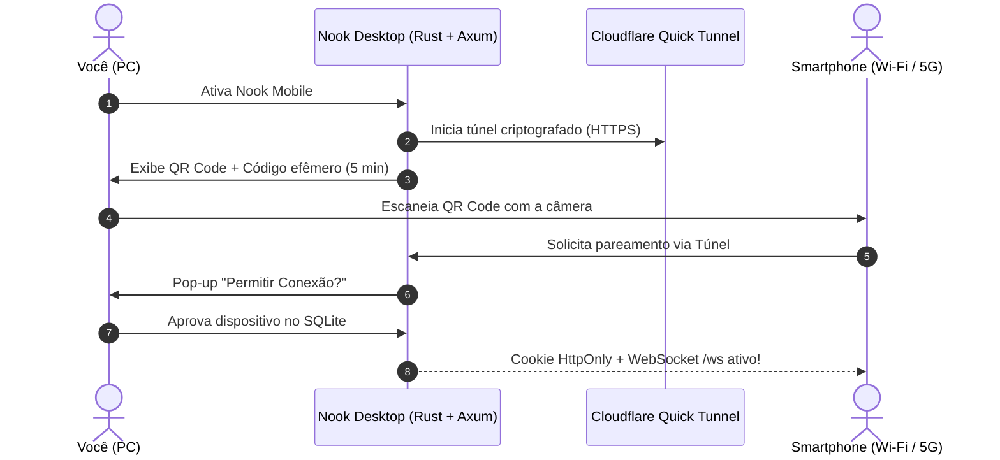

<div align="center">

<br />


&nbsp;&nbsp;&nbsp;


# Nook

### Seu refúgio minimalista, rápido e 100% local-first para notas, projetos e conhecimento.

<p>
  <a href="https://github.com/zeitgeist2004/Nook/releases/latest">
    
  </a>
  
  
  
  <a href="./LICENSE">
    
  </a>
</p>

<p>
  <a href="#-download-e-instalação-windows">⬇️ Baixar EXE / Instalador</a> •
  <a href="#-recursos-principais">✨ Recursos</a> •
  <a href="#-nook-web-mobile-e-voice">📱 Web & Mobile</a> •
  <a href="#-atalhos-de-teclado">⌨️ Atalhos</a> •
  <a href="#-compilar-do-código-fonte">🛠️ Desenvolvimento</a>
</p>

</div>

---

## ⬇️ Download e Instalação (Windows)

Escolha o formato que preferir diretamente nos lançamentos oficiais (**[GitHub Releases](https://github.com/zeitgeist2004/Nook/releases/latest)**):

| Formato | Indicado para | Download Direto |
| :--- | :--- | :--- |
| **Instalador `.exe` (NSIS)** | Instalação tradicional no Windows com atalhos e associação de arquivos `.md` / `.txt` *(Recomendado)* | [](https://github.com/zeitgeist2004/Nook/releases/download/v1.0.0/Nook-1.0.0-Setup.exe) |
| **Instalador `.msi` (Windows Installer)** | Instalação corporativa / pacote MSI padrão Windows x64 | [](https://github.com/zeitgeist2004/Nook/releases/download/v1.0.0/Nook-1.0.0-x64.msi) |
| **Versão Portátil (`.zip`)** | Extrair e usar sem instalar (já inclui `Nook.exe`, `WebView2Loader.dll` e `cloudflared.exe` para Nook Mobile) | [](https://github.com/zeitgeist2004/Nook/releases/download/v1.0.0/Nook-Portatil-Completo.zip) |
| **Executável Avulso (`.exe`)** | Execução direta do binário compilado `Nook.exe` | [](https://github.com/zeitgeist2004/Nook/releases/download/v1.0.0/Nook.exe) |

> [!TIP]
> Quer abrir qualquer `.md` ou `.txt` do Windows diretamente com o Nook? Após instalar via `Nook-1.0.0-Setup.exe`, clique com o botão direito em um arquivo `.md` → **Abrir com** → **Nook** e marque **Sempre**. Suas edições serão salvas no arquivo original com proteção contra gravações acidentais e suporte a UTF-8, UTF-16 e Windows-1252.

---

## ✨ Recursos Principais

- **100% Offline e Local-First:** Sem conta, sem login, sem nuvem obrigatória e zero telemetria. Tudo fica gravado em SQLite nativo com `PRAGMA journal_mode = WAL`.
- **Editor CodeMirror 6 + Leitor Markdown:** Modos **Edição**, **Dividido (Split)** e **Leitura**, alternáveis com 1 clique.
- **Organização Fluida:** Projetos, subpastas aninhadas com detecção de ciclos, **Notas Rápidas**, abas múltiplas (até 5 abas simultâneas), fixação (`Pin`) e **reordenação por arrastar e soltar** na barra lateral.
- **Auto-Save Inteligente & Histórico de Versões:** Debounce de 350ms com rascunho de recuperação contra quedas e snapshots automáticos/manuais restauráveis.
- **Busca Instantânea (`Ctrl + K`):** Pesquisa indexada em tempo real via SQLite **FTS5** e paleta de comandos estilo Raycast.
- **System Tray no Windows:** Feche para a bandeja do sistema mantendo acesso rápido e atalho global (`Ctrl + Alt + N`).
- **Backups Automáticos & Portabilidade:** Backups diários locais (retenção de 7 dias), exportação/restauração completa em `.json` e exportação estruturada de toda a biblioteca em pastas e arquivos `.md`.

---

## 🎨 Explore os Recursos Interativos

<details>
<summary><b>📝 1. Markdown Turbinado (Callouts, Wikilinks, Checkboxes e Frontmatter)</b></summary>
<br />

O motor de Markdown do Nook suporta recursos avançados prontos para uso:

- **Obsidian Callouts:** `> [!note]`, `> [!tip]`, `> [!warning]`, `> [!important]` renderizados com ícones e destaque visual.
- **Wikilinks:** `[[Nome da Nota]]` ou `[[Nota Original|Texto Customizado]]` — clique no modo leitura para navegar ou criar a nota instantaneamente.
- **Checkboxes Interativas:** `- [ ] Tarefa` — clique diretamente no modo de leitura para marcar/desmarcar e atualizar o Markdown em tempo real.
- **Frontmatter YAML & Hashtags:** Propriedades no topo (`---`) exibidas em cartões organizados + reconhecimento de `#tags` fora de blocos de código.

</details>

<details>
<summary><b>🎨 2. Cinco Temas Visuais Integrados (Desktop, Web & Mobile sincronizados)</b></summary>
<br />

| Tema | Estilo | Destaque |
| :--- | :--- | :--- |
| **Cinza (`gray`)** | Minimalista grafite balanceado | Padrão confortável para leitura prolongada |
| **Escuro (`dark`)** | Contraste OLED profundo | Preto puro `#000000` para ambientes noturnos |
| **Claro (`white`)** | Papel limpo e nítido | Alto contraste diurno |
| **Neon (`neon`)** | Terminal Cyberpunk / Cibersegurança | Preto absoluto, branco e verde neon `#00FF9D` |
| **Sakura (`sakura`)** | Suave e delicado | Tons escuros acolhedores com destaque rosé |

</details>

<details>
<summary><b>📱 3. Nook Web, Nook Mobile & Nook Voice (Sincronização em Tempo Real)</b></summary>
<br />

- **Nook Web:** Abra sua biblioteca instantaneamente no navegador local (`127.0.0.1`) via servidor **Axum** embutido em Rust com proteção contra DNS Rebinding, sessão `HttpOnly` e WebSocket em tempo real.
- **Nook Mobile (Wi-Fi e 5G):** Ative o túnel seguro **Cloudflare Quick Tunnel** (`cloudflared`), escaneie o **QR Code offline** no celular e aprove a conexão 2FA diretamente na tela do PC. Seus dados continuam **apenas no seu computador**.
- **Nook Voice:** Crie notas ou transcrições de reunião por voz no celular ou navegador com persistência progressiva e fila de recuperação offline via IndexedDB.



</details>

<details>
<summary><b>⌨️ 4. Atalhos de Teclado</b></summary>
<br />

| Atalho | Ação |
| :--- | :--- |
| `Ctrl + N` | Criar nova nota rápida |
| `Ctrl + Alt + N` | Captura rápida global |
| `Ctrl + K` ou `Ctrl + P` | Abrir busca instantânea e paleta de comandos |
| `Ctrl + B` | Recolher / expandir barra lateral |
| `Ctrl + S` | Forçar salvamento imediato |
| `Ctrl + ,` | Abrir Configurações |
| `Ctrl + /` | Abrir guia rápido de atalhos |
| `Esc` | Fechar modais, menus ou lixeira |

</details>

---

## 🔒 Privacidade & Arquitetura

| Camada | Tecnologia |
| :--- | :--- |
| **Core Desktop** | Tauri 2 + Rust (Edition 2024) |
| **Banco de Dados** | SQLite local (`WAL` + `FTS5` + chaves estrangeiras) |
| **Frontend** | React 18 + TypeScript + Vite |
| **Editor & Preview** | CodeMirror 6 + `marked` + `DOMPurify` |
| **Servidor & Sync** | Axum HTTP/WebSocket + Cloudflare Quick Tunnel opcional |

- Nenhuma chave de API, telemetria, conta externa ou servidor central é usado.
- Todos os arquivos pessoais de notas e preferências permanecem exclusivamente no dispositivo do usuário.
- Consulte [docs/NOOK_MOBILE.md](./docs/NOOK_MOBILE.md) para detalhes técnicos completos de segurança, pareamento 2FA e arquitetura do túnel.

---

## 🛠️ Compilar do Código-Fonte

### Pré-requisitos
- **Node.js >= 18** e **npm**
- **Rust >= 1.90** (`rustup` / `cargo`) e pré-requisitos do Tauri para Windows (WebView2 + Build Tools)

### Executar em Desenvolvimento e Testar

```bash
# 1. Instalar dependências do frontend
npm install

# 2. Executar suíte completa de testes e checagem de tipos
npm test
npx tsc --noEmit

# 3. Rodar aplicativo desktop em desenvolvimento
npm run tauri dev
```

### Gerar Executável e Instaladores de Produção

```bash
npm run tauri build
```

Os pacotes compilados serão gerados em `src-tauri/target/release/` (`app.exe` e bundles `.exe` / `.msi`).

<br />

<div align="center">
  
  <br />
  <sub>Feito por <a href="https://github.com/zeitgeist2004">zeitgeist2004</a> • Licença <a href="./LICENSE">MIT</a></sub>
</div>
