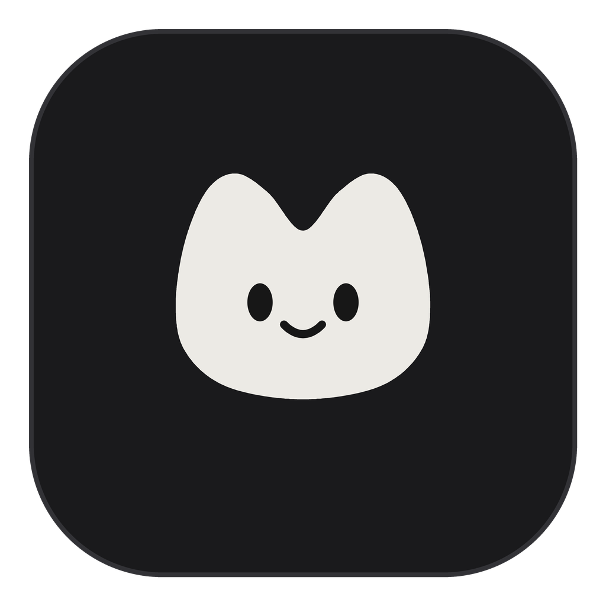
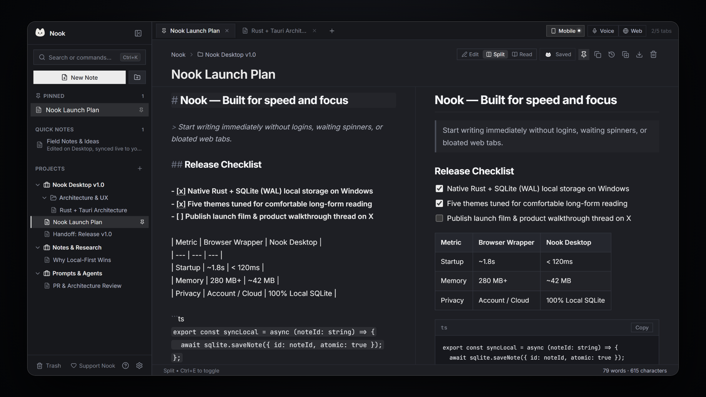
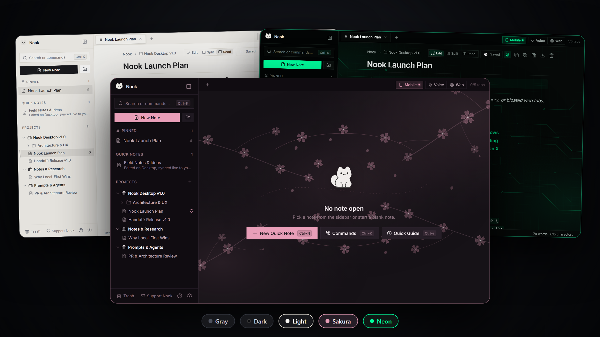
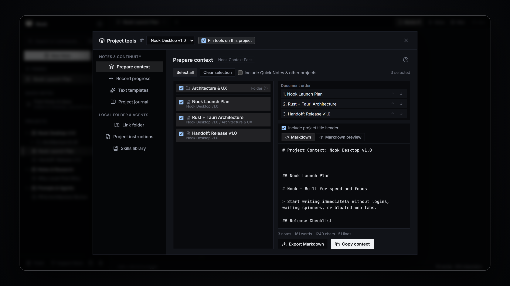
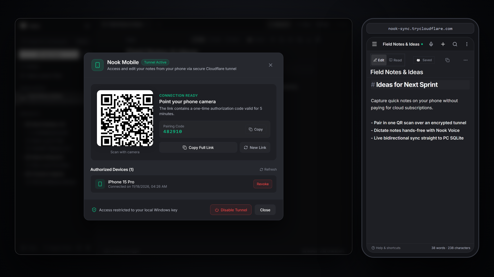
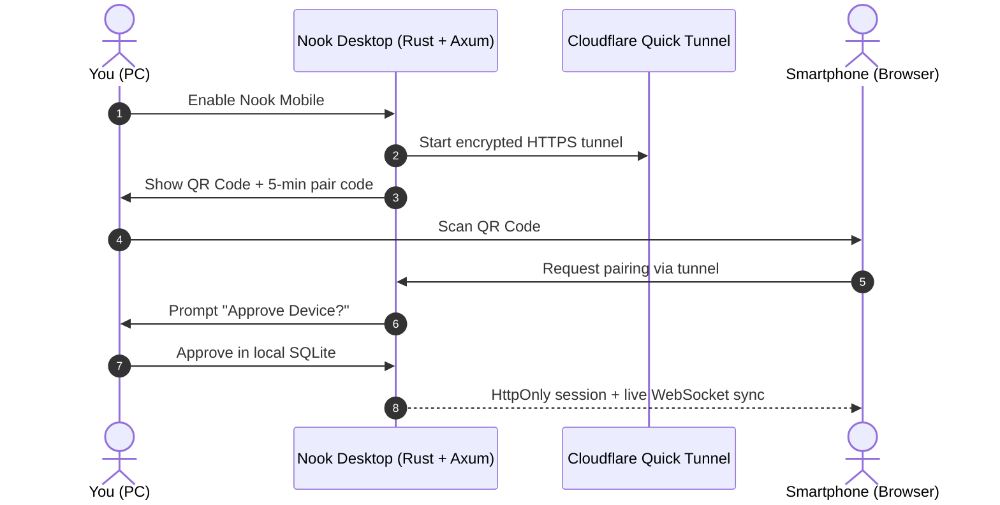
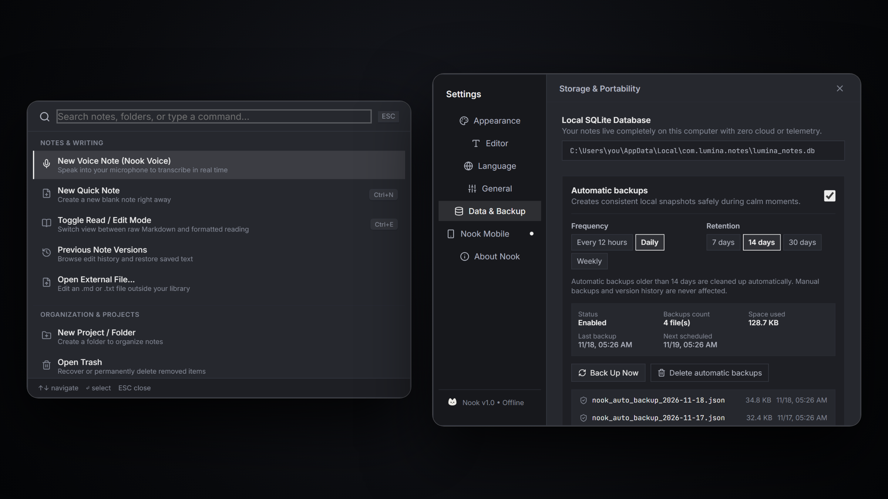

<div align="center">

<br />


&nbsp;&nbsp;&nbsp;


# Nook

### Minimalist, fast, 100% local-first notes and project workspace for Windows, Web, and Mobile.

<p>
  <strong>🌐 Language:</strong>
  &nbsp;<b>English</b>
  &nbsp;•&nbsp;
  <a href="./README.pt-BR.md">Português (BR)</a>
  &nbsp;•&nbsp;
  <a href="./README.es.md">Español</a>
</p>

<p>
  <a href="https://github.com/zeitgeist2004/Nook/releases/latest">
    
  </a>
  
  
  
  <a href="./LICENSE">
    
  </a>
</p>

<p>
  <a href="#-download--install-windows">⬇️ Download</a> •
  <a href="#-capture--split-markdown">✨ Markdown</a> •
  <a href="#-five-crafted-themes">🎨 Themes</a> •
  <a href="#-developer-workflow--ai-continuity">⚡ Dev Workflow</a> •
  <a href="#-nook-web-mobile--voice">📱 Mobile & Voice</a> •
  <a href="#-instant-command-palette--offline-backups">🔍 Search & Backups</a> •
  <a href="#-build-from-source">🛠️ Build</a>
</p>

</div>

---

## ✨ Capture & Split Markdown

**Stop losing ideas in scattered `.txt` files or waiting on heavy browser wrappers just to jot down a line.**  
Open Nook and write immediately — zero accounts, zero mandatory cloud, and native Rust + SQLite speed.

<p align="center">
  
</p>

- **Edit, Split, or Read in One Click (`Ctrl + E`):** Write raw Markdown in CodeMirror 6 while inspecting formatted tables, checklists, blockquotes, callouts, and code blocks live side by side.
- **Calm Workspace Structure:** Keep **Quick Notes** and pinned items at the top, organize projects into nested folders with smooth drag-and-drop, and work across up to **5 simultaneous tabs**.
- **Atomic 350ms Auto-Save & Crash Recovery:** Every keystroke persists safely to local SQLite (`WAL` mode) with a live **`Saved`** status badge and restorable edit history.
- **Native Windows `.md` & `.txt` Editing:** Right-click any external file in Explorer → **Open with Nook** to edit safely on disk (UTF-8, UTF-16, and Windows-1252).

<details>
<summary><b>📝 Supported Markdown Syntax (Callouts, Wikilinks, Checklists & YAML Frontmatter)</b></summary>
<br />

- **Callout Blocks:** `> [!note]`, `> [!tip]`, `> [!warning]`, and `> [!important]` rendered with clean visual accents.
- **Instant `[[Wikilinks]]`:** Link across notes with `[[Note Name]]` or `[[Target Note|Custom Label]]` — click in Read mode to jump straight there or create the target note on the spot.
- **Live Interactive Checklists:** Toggle `- [ ] Task` items directly in Read mode while keeping your underlying Markdown in sync.
- **YAML Frontmatter & Inline Tags:** Structured metadata cards (`---`) and `#tags` parsed cleanly without cluttering your prose.

</details>

---

## ⬇️ Download & Install (Windows)

Grab the latest release straight from **[GitHub Releases](https://github.com/zeitgeist2004/Nook/releases/latest)**:

| Format | Best For | Direct Download |
| :--- | :--- | :--- |
| **`.exe` Installer (NSIS)** | Standard Windows install with shortcuts, `.md` / `.txt` associations, and built-in auto-updates *(Recommended)* | [](https://github.com/zeitgeist2004/Nook/releases/latest) |
| **`.msi` Installer (Windows Installer)** | Enterprise / standard x64 Windows Installer package | [](https://github.com/zeitgeist2004/Nook/releases/latest) |
| **Portable `.zip`** | Extract and launch anywhere without installing (includes `Nook.exe`, `WebView2Loader.dll`, and `cloudflared.exe` for Nook Mobile) | [](https://github.com/zeitgeist2004/Nook/releases/latest) |
| **Standalone `.exe`** | Direct single-binary launch (`Nook.exe`) | [](https://github.com/zeitgeist2004/Nook/releases/latest) |

> [!TIP]
> Want Nook as your fast default Markdown viewer on Windows? Right-click any `.md` or `.txt` file → **Open with** → **Nook** → **Always**.

---

## 🎨 Five Crafted Themes

**Harsh pure-white screens strain your eyes at night, while lifeless gray templates kill focus.**  
Nook pairs five purpose-built themes calibrated for long reading and coding sessions — synced seamlessly across **Desktop, Web, and Mobile**.

<p align="center">
  
</p>

- **Sakura (`sakura`) & Neon (`neon`):** Signature minimalist atmospheres — soft plum tones framed with `#E89EB8` five-petal cherry blossoms, or crisp terminal contrast with `#00FF9D` PCB traces and subtle grid backdrops.
- **Light (`white`), Dark (`dark`), & Gray (`gray`):** Warm editorial paper (`#FAF9F6`) for sunlit desks, deep dark contrast (`#090A0D`) for late-night focus, and balanced graphite as a calm daily default.
- **Built-In Accessibility & Multilingual UI:** Full native interface in **English**, **Português (BR)**, and **Español**, plus customizable editor font families and spacing.

---

## ⚡ Developer Workflow & AI Continuity

**Tired of hunting down prompts, docs, and where you left off yesterday before starting a coding session?**  
Without turning your notes app into a bloated IDE, **Project Tools** keeps every project organized and AI-ready in seconds.

<p align="center">
  
</p>

- **1-Click Context Pack (`Prepare context`):** Select notes and folders, drag or reorder document flow, preview combined Markdown, and export or copy a structured workspace brief with one click.
- **Continuity Without Friction:** Capture end-of-day **Session Handoffs** (`Record progress`), keep a running **Project journal**, and store reusable **Text templates** right next to your notes.
- **Local Folder & Agent File Reader:** Link a repository folder on disk to browse project instructions (`CLAUDE.md`, `AGENTS.md`) and inspect your local **Skills library** (`SKILL.md`) right inside Nook.

---

## 📱 Nook Web, Mobile & Voice

**Need to capture a thought on the move or browse your notes from another room — without handing your library to a cloud subscription?**  
Your PC remains the single source of truth while Nook serves live access over your local network or an encrypted tunnel.

<p align="center">
  
</p>

- **Instant QR Pairing (`Cloudflare Quick Tunnel`):** Enable Nook Mobile, point your phone camera at the QR code (with a 5-minute single-use code), and approve 2FA authorization right on Windows.
- **Full Device Control:** See active paired devices under **Authorized Devices**, lock access to your local key, and hit **Revoke** anytime to sever a session immediately.
- **Nook Web (`127.0.0.1`) & Nook Voice:** Open your notes in a desktop browser through the embedded **Rust Axum** server with real-time WebSocket updates, or dictate voice notes hands-free with offline queue recovery.

<details>
<summary><b>🔐 How Zero-Cloud QR Pairing Works (Architecture Diagram)</b></summary>
<br />



See [docs/NOOK_MOBILE.md](./docs/NOOK_MOBILE.md) for the complete pairing security model and DNS-rebinding protections.

</details>

---

## 🔍 Instant Command Palette & Offline Backups

**Your workspace should stay lightning fast after thousands of notes — and never hold your data hostage in proprietary formats.**

<p align="center">
  
</p>

- **Zero-Latency Command Palette (`Ctrl + K` / `Ctrl + P`):** Powered by SQLite **FTS5** full-text search — filter notes, create Voice or Quick Notes, jump into previous versions, open external `.md` / `.txt` files, or manage Trash without touching the mouse.
- **Automated Local `.json` Backups:** Schedule consistent background snapshots (**Every 12 hours**, **Daily**, or **Weekly**) with automatic retention cleanup (**7**, **14**, or **30 days**) — manual backups and version history are never purged.
- **Full `.md` Folder Export & Signed Updates:** Export your entire library cleanly as portable `.md` files anytime, and stay current with optional cryptographic auto-updates via GitHub Releases.

<details>
<summary><b>⌨️ Essential Keyboard Shortcuts</b></summary>
<br />

| Shortcut | Action |
| :--- | :--- |
| `Ctrl + N` | New quick note |
| `Ctrl + Alt + N` | Global quick capture (Windows) |
| `Ctrl + K` or `Ctrl + P` | Instant search & command palette |
| `Ctrl + E` | Cycle Edit / Split / Read view |
| `Ctrl + B` | Toggle sidebar |
| `Ctrl + S` | Force immediate save |
| `Ctrl + ,` | Open Settings |
| `Ctrl + /` | Quick shortcut guide |

</details>

---

## 🔒 Privacy & Architecture

| Layer | Stack |
| :--- | :--- |
| **Desktop Core** | Tauri 2 + Rust (Edition 2024) |
| **Database** | Native SQLite (`WAL` + `FTS5` + foreign keys) |
| **Frontend** | React 18 + TypeScript + Vite |
| **Editor & Preview** | CodeMirror 6 + `marked` + `DOMPurify` |
| **Sync & Tunnel** | Embedded Axum HTTP/WebSocket + optional Cloudflare Quick Tunnel |

- Zero accounts, zero analytics, zero third-party telemetry.
- All notes, backups, and settings live locally on your computer.

---

## 🛠️ Build from Source

### Prerequisites
- **Node.js >= 18** and **npm**
- **Rust >= 1.90** (`rustup` / `cargo`) and Windows Tauri prerequisites (WebView2 + MSVC Build Tools)

```bash
# 1. Install frontend dependencies
npm install

# 2. Run test suite & type check
npm test
npx tsc --noEmit

# 3. Start desktop development mode
npm run tauri dev

# 4. Build production executable & Windows installers
npm run tauri build
```

---

## ❤️ Support Nook

Nook is 100% free and open-source — no paywalls, no ads, and no locked Pro features.  
If Nook helps your daily workflow, consider supporting development on **[GitHub Sponsors](https://github.com/sponsors/zeitgeist2004)**.

<div align="center">
  <br />
  
  <br />
  <sub>Built by <a href="https://github.com/zeitgeist2004">zeitgeist2004</a> • <a href="./LICENSE">MIT License</a></sub>
</div>
