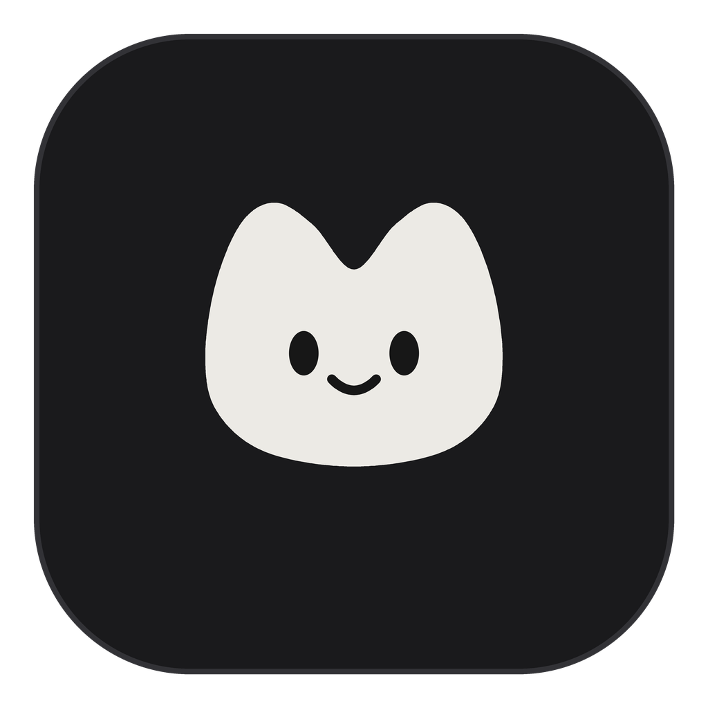
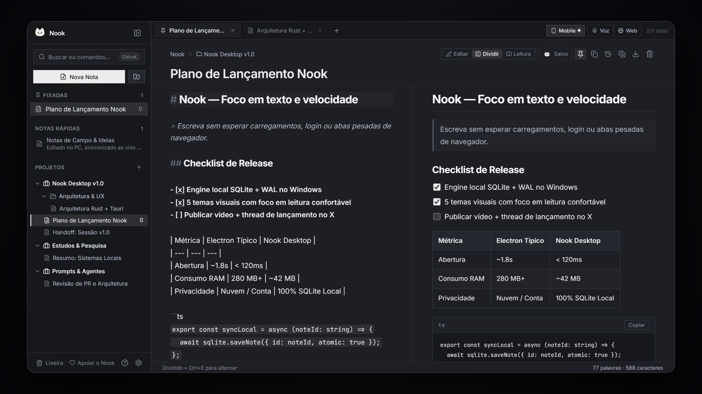
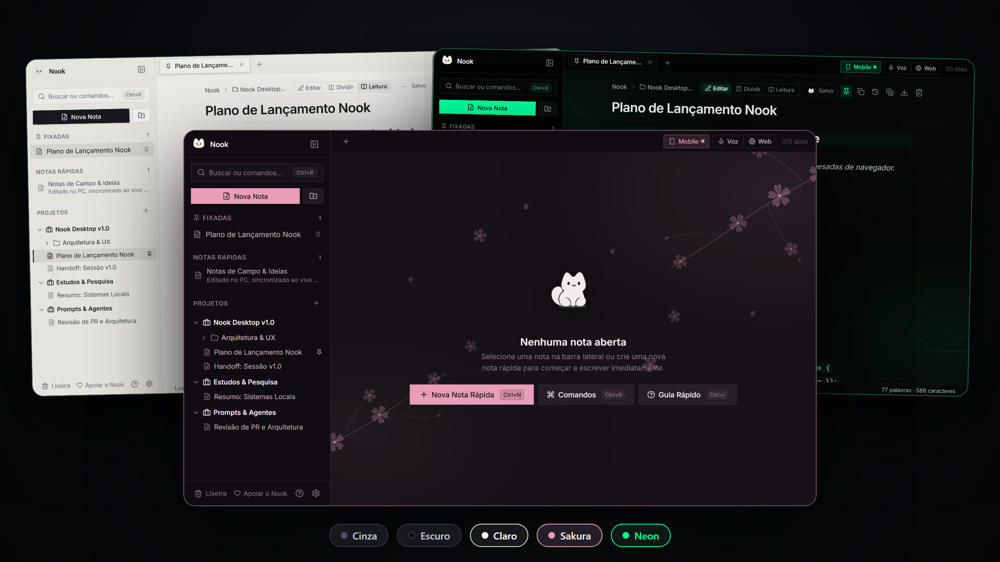
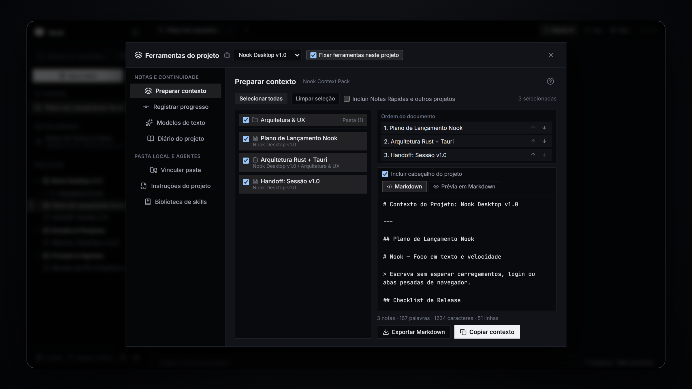
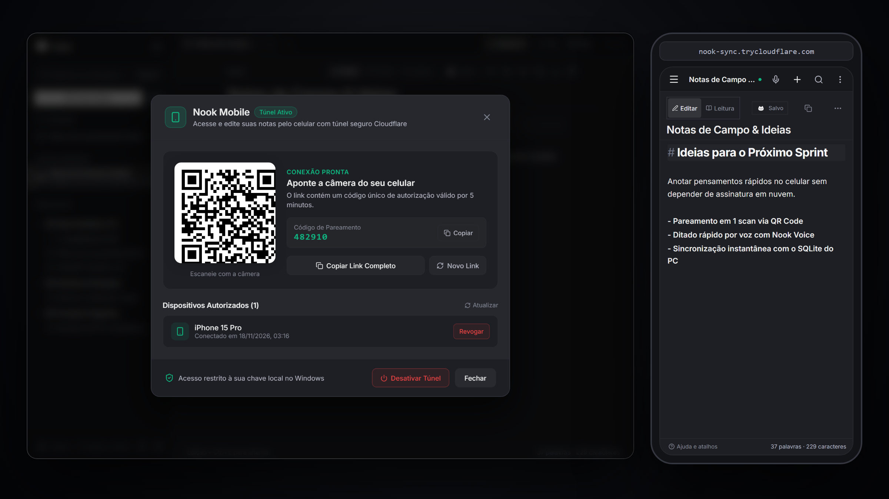
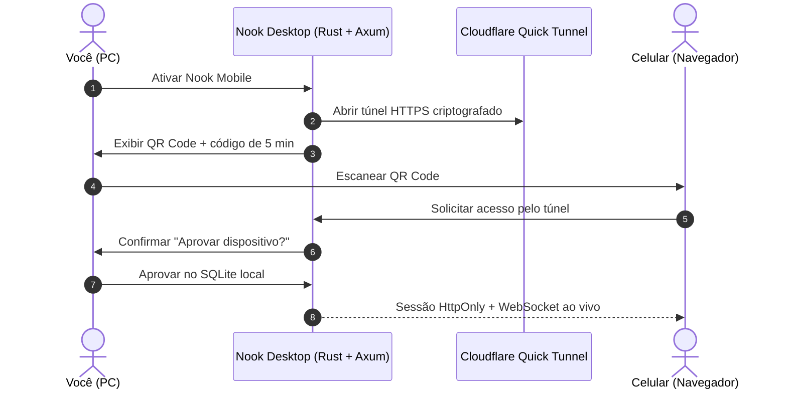
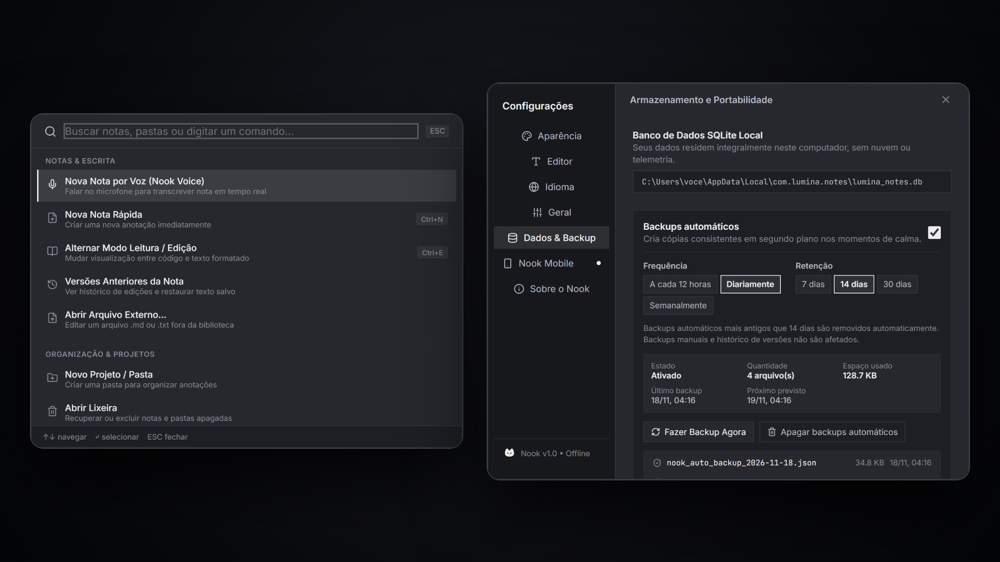

<div align="center">

<br />


&nbsp;&nbsp;&nbsp;


# Nook

### Seu espaço minimalista, rápido e 100% local-first para notas, projetos e fluxos de trabalho no Windows, Web e Mobile.

<p>
  <strong>🌐 Idioma:</strong>
  &nbsp;<a href="./README.md">English</a>
  &nbsp;•&nbsp;
  <b>Português (BR)</b>
  &nbsp;•&nbsp;
  <a href="./README.es.md">Español</a>
</p>

<p>
  <a href="https://github.com/zeitgeist2004/Nook/releases/latest">
    
  </a>
  
  
  
  <a href="./LICENSE">
    
  </a>
</p>

<p>
  <a href="#-download-e-instalação-windows">⬇️ Baixar</a> •
  <a href="#-captura-instantânea-e-markdown-dividido">✨ Markdown</a> •
  <a href="#-cinco-temas-visuais">🎨 Temas</a> •
  <a href="#-fluxo-dev-e-agentes-de-ia">⚡ Fluxo Dev</a> •
  <a href="#-nook-web-mobile-e-voz">📱 Mobile & Voz</a> •
  <a href="#-busca-instantânea-e-backups-offline">🔍 Busca & Backups</a> •
  <a href="#-compilar-do-código-fonte">🛠️ Compilar</a>
</p>

</div>

---

## ✨ Captura Instantânea e Markdown Dividido

**Chega de perder ideias em dezenas de `.txt` soltos ou esperar apps pesados abrirem só para anotar uma linha.**  
No Nook você abre e escreve na hora — sem conta, sem nuvem obrigatória e com velocidade nativa em Rust + SQLite.

<p align="center">
  
</p>

- **Editar, Dividir ou Ler em 1 clique (`Ctrl + E`):** Escreva Markdown em CodeMirror 6 enquanto visualiza checklists, tabelas, citações, callouts e blocos de código renderizados ao lado em tempo real.
- **Organização leve e sem atrito:** Deixe **Notas Rápidas** e itens fixados no topo, organize projetos em subpastas com drag & drop e trabalhe com até **5 abas abertas** simultaneamente.
- **Auto-Save atômico em 350ms & Histórico:** Cada edição vai direto para o SQLite local (`WAL`) com indicador **`Salvo`** ao vivo, rascunho de recuperação e versões anteriores restauráveis.
- **Edição nativa de `.md` e `.txt` no Windows:** Clique direito em qualquer arquivo → **Abrir com Nook** para editar direto no disco com suporte a UTF-8, UTF-16 e Windows-1252.

<details>
<summary><b>📝 Sintaxe Markdown Completa (Callouts, Wikilinks, Checklists e Frontmatter)</b></summary>
<br />

- **Blocos Callout:** `> [!note]`, `> [!tip]`, `> [!warning]` e `> [!important]` com destaque visual limpo.
- **Wikilinks `[[Nota]]`:** Conecte anotações com `[[Nome da Nota]]` ou `[[Nota Alvo|Texto]]` — clique no modo leitura para navegar ou criar a nota na hora.
- **Checklists interativas:** Marque e desmarque `- [ ] Tarefa` direto no modo leitura atualizando o Markdown automaticamente.
- **Frontmatter YAML & Hashtags:** Propriedades no topo da nota (`---`) exibidas em cartão organizado + reconhecimento de `#tags`.

</details>

---

## ⬇️ Download e Instalação (Windows)

Baixe o formato que preferir em **[GitHub Releases](https://github.com/zeitgeist2004/Nook/releases/latest)**:

| Formato | Indicado para | Download Direto |
| :--- | :--- | :--- |
| **Instalador `.exe` (NSIS)** | Instalação padrão no Windows com atalhos, associação `.md`/`.txt` e atualização automática *(Recomendado)* | [](https://github.com/zeitgeist2004/Nook/releases/latest) |
| **Instalador `.msi` (Windows Installer)** | Pacote MSI padrão Windows x64 | [](https://github.com/zeitgeist2004/Nook/releases/latest) |
| **Versão Portátil (`.zip`)** | Extrair e usar sem instalar (inclui `Nook.exe`, `WebView2Loader.dll` e `cloudflared.exe` para o Nook Mobile) | [](https://github.com/zeitgeist2004/Nook/releases/latest) |
| **Executável Avulso (`.exe`)** | Execução direta do binário `Nook.exe` | [](https://github.com/zeitgeist2004/Nook/releases/latest) |

> [!TIP]
> Quer abrir qualquer `.md` ou `.txt` no Windows direto com o Nook? Clique com o botão direito no arquivo → **Abrir com** → **Nook** → **Sempre**.

---

## 🎨 Cinco Temas Visuais

**Tela branca estourada destrói a vista à noite, e cinza corporativo sem vida tira a vontade de ler.**  
O Nook traz cinco temas calibrados para longas sessões de leitura e código — sincronizados automaticamente entre **Desktop, Web e Mobile**.

<p align="center">
  
</p>

- **Sakura (`sakura`) e Neon (`neon`):** Atmosferas minimalistas autorais — tons ameixa suaves com flores de cerejeira `#E89EB8`, ou contraste terminal com trilhas PCB e grade verde `#00FF9D`.
- **Claro (`white`), Escuro (`dark`) e Cinza (`gray`):** Papel quente editorial (`#FAF9F6`) para leitura diurna, contraste profundo (`#090A0D`) para foco noturno e grafite equilibrado como padrão diário.
- **Interface Multilíngue Nativa:** Experiência completa em **Português (BR)**, **English** e **Español**, com ajuste fino de fonte e conforto visual no editor.

---

## ⚡ Fluxo Dev e Agentes de IA

**Cansado de caçar prompts espalhados, arquivos perdidos e tentar lembrar onde parou ontem antes de começar a codar?**  
Sem transformar seu app de notas em uma IDE pesada, as **Ferramentas do projeto** organizam todo o contexto da sua sessão em segundos.

<p align="center">
  
</p>

- **Context Pack em 1 clique (`Preparar contexto`):** Marque notas e pastas do projeto, reordene os documentos, visualize a prévia em Markdown e copie ou exporte tudo pronto com um clique.
- **Continuidade sem fricção:** Registre o **Session Handoff** (`Registrar progresso`), mantenha um **Diário do projeto** e guarde **Modelos de texto** reutilizáveis ao lado das suas anotações.
- **Pasta local & leitura para agentes:** Vincule uma pasta real do projeto no disco para ler instruções (`CLAUDE.md`, `AGENTS.md`) e consultar sua **Biblioteca de skills** (`SKILL.md`) direto no Nook.

---

## 📱 Nook Web, Mobile e Voz

**Precisa anotar no celular ou abrir suas notas em outro dispositivo — sem pagar mensalidade de nuvem para terceiros?**  
Seu PC continua sendo a única fonte da verdade enquanto o Nook sincroniza ao vivo pela rede local ou por túnel criptografado.

<p align="center">
  
</p>

- **Pareamento por QR Code (`Cloudflare Quick Tunnel`):** Ative o Nook Mobile, aponte a câmera do celular para o QR Code (código único válido por 5 minutos) e aprove a entrada 2FA na tela do Windows.
- **Controle total de acesso:** Gerencie sessões em **Dispositivos Autorizados**, restrinja à sua chave local do Windows e clique em **Revogar** a qualquer momento para desconectar um aparelho.
- **Nook Web (`127.0.0.1`) & Nook Voice:** Acesse pelo navegador local via servidor Rust **Axum** com WebSockets ao vivo, ou dite notas rápidas por voz com fila de recuperação offline.

<details>
<summary><b>🔐 Como funciona o pareamento seguro sem nuvem (Diagrama)</b></summary>
<br />



Consulte [docs/NOOK_MOBILE.md](./docs/NOOK_MOBILE.md) para o modelo completo de segurança do pareamento e proteção contra DNS rebinding.

</details>

---

## 🔍 Busca Instantânea e Backups Offline

**Seu workspace precisa abrir instantaneamente mesmo com milhares de notas — e seus arquivos devem continuar livres e portáveis para sempre.**

<p align="center">
  
</p>

- **Paleta de Comandos sem latência (`Ctrl + K` / `Ctrl + P`):** Pesquisa instantânea via SQLite **FTS5** — filtre notas, inicie uma **Nota por Voz**, restaure versões anteriores, abra arquivos externos `.md`/`.txt` ou acesse a Lixeira direto pelo teclado.
- **Backups automáticos locais em `.json`:** Configure frequência (**A cada 12 horas**, **Diariamente** ou **Semanalmente**) e retenção (**7**, **14** ou **30 dias**) — backups manuais e histórico de versões nunca são removidos.
- **Exportação completa em `.md` & Auto-Update:** Exporte toda a biblioteca para arquivos `.md` portáteis a qualquer hora e receba atualizações assinadas via GitHub Releases.

<details>
<summary><b>⌨️ Atalhos de Teclado Essenciais</b></summary>
<br />

| Atalho | Ação |
| :--- | :--- |
| `Ctrl + N` | Nova nota rápida |
| `Ctrl + Alt + N` | Captura rápida global (Windows) |
| `Ctrl + K` ou `Ctrl + P` | Busca instantânea e paleta de comandos |
| `Ctrl + E` | Alternar Editar / Dividir / Leitura |
| `Ctrl + B` | Mostrar ou ocultar barra lateral |
| `Ctrl + S` | Salvar imediatamente |
| `Ctrl + ,` | Abrir Configurações |
| `Ctrl + /` | Guia rápido de atalhos |

</details>

---

## 🔒 Privacidade e Arquitetura

| Camada | Stack |
| :--- | :--- |
| **Core Desktop** | Tauri 2 + Rust (Edition 2024) |
| **Banco de Dados** | SQLite local (`WAL` + `FTS5` + chaves estrangeiras) |
| **Frontend** | React 18 + TypeScript + Vite |
| **Editor & Preview** | CodeMirror 6 + `marked` + `DOMPurify` |
| **Sync & Túnel** | Servidor Axum HTTP/WebSocket embutido + Cloudflare Quick Tunnel opcional |

- Zero contas, zero analytics, zero telemetria de terceiros.
- Todas as notas, backups e configurações permanecem no seu computador.

---

## 🛠️ Compilar do Código-Fonte

### Pré-requisitos
- **Node.js >= 18** e **npm**
- **Rust >= 1.90** (`rustup` / `cargo`) e pré-requisitos do Tauri no Windows (WebView2 + MSVC Build Tools)

```bash
# 1. Instalar dependências do frontend
npm install

# 2. Rodar suíte de testes e checagem de tipos
npm test
npx tsc --noEmit

# 3. Iniciar modo desenvolvimento desktop
npm run tauri dev

# 4. Gerar executável final e instaladores Windows
npm run tauri build
```

---

## ❤️ Apoiar o Nook

O Nook é 100% gratuito e open-source — sem paywall, sem anúncios e sem recursos Pro travados.  
Se ele ajuda no seu dia a dia, você pode apoiar o projeto pelo **[GitHub Sponsors](https://github.com/sponsors/zeitgeist2004)**.

<div align="center">
  <br />
  
  <br />
  <sub>Feito por <a href="https://github.com/zeitgeist2004">zeitgeist2004</a> • <a href="./LICENSE">Licença MIT</a></sub>
</div>
